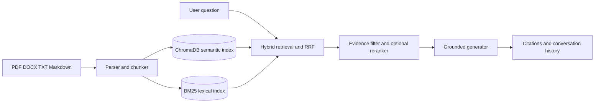

# Hybrid RAG Pipeline


A small, production-shaped retrieval-augmented generation service that combines:

- semantic search with ChromaDB embeddings;
- keyword search with BM25;
- reciprocal-rank fusion (RRF) to merge both rankings;
- source-aware answers with inline citations;
- PDF page and DOCX section-aware citations;
- a FastAPI interface for ingestion and querying.

The service works without an LLM: it returns an extractive answer assembled from the best passages. If `OPENAI_API_KEY` is set, it can instead synthesize an answer with an OpenAI model while being constrained to the retrieved context.

Cross-encoder reranking is optional. Install `requirements-reranker.txt` and set
`RERANKER_ENABLED=true` when you want the Hugging Face reranker; the default
Docker image keeps this heavyweight dependency disabled.

Answers are filtered by semantic evidence, require valid inline citations, and fall
back to extractive output if an LLM returns missing or invalid citation markers.

## Portfolio summary

Atlas is a production-shaped hybrid RAG application for answering questions over
company documents with traceable evidence. It demonstrates semantic retrieval,
BM25 keyword search, reciprocal-rank fusion, optional cross-encoder reranking,
grounded generation, source-linked citations, asynchronous ingestion, user
isolation, conversation history, observability, security middleware, Docker, and
CI quality gates.

**Tech:** Python, FastAPI, ChromaDB, BM25, SQLite, Docker, GitHub Actions.

**Highlights:** 43 automated tests, retrieval regression evaluation, configurable
search modes, citation-linked originals, responsive web UI, and a reusable
deployment smoke test.

See [PORTFOLIO.md](PORTFOLIO.md) for resume wording, a project description, and
a short demo-video script.

## Quick start

Python 3.11 or 3.12 is recommended (some dependencies may not yet support Python 3.14).

```powershell
cd project-1-hybrid-rag
python -m venv .venv
.venv\Scripts\Activate.ps1
pip install -r requirements.txt
python -m uvicorn app.main:app --reload --host 127.0.0.1 --port 8001
```

Using `python -m uvicorn` also works on managed Windows machines where Application
Control blocks the generated `uvicorn.exe` launcher.

Open `http://127.0.0.1:8001/docs` for the interactive API documentation. If port
`8001` is unavailable on another machine, select a different unreserved local port.

Open `http://127.0.0.1:8001/` for the Atlas web application. It provides drag-and-drop
uploads, a streaming chat experience, evidence-scored citation cards, API health,
document deletion, and recent conversation history without requiring a separate
frontend build step. Conversations are persisted in SQLite at `atlas.db`.

### Run with Docker Compose

Docker Compose persists ChromaDB and SQLite data in named volumes and publishes
the API on port `8000` by default. Copy `.env.docker.example` to `.env.docker`,
then run:

```powershell
Copy-Item .env.docker.example .env.docker
docker compose up --build -d
Invoke-RestMethod http://127.0.0.1:8000/health
Invoke-RestMethod http://127.0.0.1:8000/ready
docker compose down
```

Set `ATLAS_PORT` to use another host port, for example
`$env:ATLAS_PORT=8019` before starting Compose. The container healthcheck uses
`/ready`, so it only becomes healthy after both persistence backends initialize.

### Deploy to Render

The repository includes `render.yaml` for a Docker-based Render service. In the
Render dashboard, choose **New → Blueprint**, connect this repository, and review
the generated `API_KEY` and persistent disk before creating the service. Set
`ALLOWED_ORIGINS` to the public API origin you will use. Render uses `/ready` as
the service health check and mounts persistent storage at `/var/lib/atlas`.

After deployment, run the end-to-end smoke test against the public URL:

```powershell
python scripts/smoke_test.py https://your-service.onrender.com --api-key YOUR_API_KEY
```

The script checks health, readiness, ingestion, hybrid retrieval, citations, and
grounding, and exits non-zero if any deployment check fails.

Large uploads use `POST /documents/upload/async` and return a job ID immediately.
Poll `GET /jobs/{job_id}` for `queued`, `processing`, `completed`, or `failed`
status. The Atlas UI handles this polling automatically.

## Authentication and isolation

Local demos use `demo-user` by default. For a protected deployment, set
`AUTH_ENABLED=true` and provide `API_KEY`. Clients send that key as `X-API-Key` and
identify their isolated workspace with `X-User-ID`. Documents, duplicate checks,
search results, deletion, and conversation history are scoped to that user.

## Use the API

Ingest one or more documents:

```powershell
$body = @{
  documents = @(
    @{
      source = "employee-handbook.md"
      title = "Employee Handbook"
      text = "Employees receive 20 days of annual leave. Requests require manager approval."
    }
  )
} | ConvertTo-Json -Depth 5

Invoke-RestMethod -Method Post -Uri http://127.0.0.1:8001/documents -ContentType application/json -Body $body
```

Ask a question:

```powershell
$body = @{ question = "How much annual leave do employees receive?" } | ConvertTo-Json
Invoke-RestMethod -Method Post -Uri http://127.0.0.1:8001/query -ContentType application/json -Body $body
```

Set `mode` to `hybrid` (default), `semantic`, or `keyword` to compare retrieval
strategies. Responses include the selected mode, retrieved chunk count, and
query latency.

Every answer includes a `citations` array containing the source, title, chunk ID, passage text, and fused relevance score. Inline markers such as `[1]` correspond to that array.

Each citation also includes a normalized `evidence_score`. Passages below
`MIN_EVIDENCE_SCORE` (default `0.25`) are excluded so unsupported questions return
an explicit no-evidence response instead of a plausible guess.

### Stream an answer

`POST /query/stream` accepts the same body as `/query` and returns server-sent
events. `token` events contain answer text and the final `complete` event contains
citations plus `grounded`, `reranked`, and `generation_mode` metadata.

```powershell
curl.exe -N -X POST "http://127.0.0.1:8001/query/stream" `
  -H "Content-Type: application/json" `
  -d '{"question":"How much annual leave do employees get?","top_k":3}'
```

### Upload files directly

The `/documents/upload` endpoint accepts PDF, DOCX, UTF-8 TXT, Markdown, or multiple
files in one request. PDF pages and DOCX headings are retained in query citations.

```powershell
curl.exe -X POST "http://127.0.0.1:8001/documents/upload" `
  -F "files=@C:\docs\employee-handbook.pdf" `
  -F "files=@C:\docs\benefits.docx"
```

Scanned image-only PDFs need OCR before upload. Each file is limited to 20 MB by
default; change `MAX_UPLOAD_MB` to adjust the limit.

Uploading identical file contents again is safe: the API detects its SHA-256 hash,
does not create duplicate chunks, and returns the filename in `duplicates_skipped`.

### Manage indexed documents

List documents and collection totals:

```powershell
Invoke-RestMethod http://127.0.0.1:8001/documents
```

Document listing supports pagination and source filtering, for example
`/documents?source=handbook&limit=20&offset=0`. Use `/ready` for a dependency
readiness check (ChromaDB and SQLite); `/health` remains a lightweight liveness
check.

Each item includes a stable `document_id`, source, title, chunk count, page count,
sections, and ingestion timestamp. Delete a document and all of its chunks using:

```powershell
Invoke-RestMethod -Method Delete `
  -Uri "http://127.0.0.1:8001/documents/{document_id}"
```

Documents indexed before this feature are exposed with a `legacy:` identifier and
remain manageable through the same endpoint.

## Optional OpenAI generation

```powershell
$env:OPENAI_API_KEY = "your-key"
$env:RAG_GENERATOR = "openai"
$env:OPENAI_MODEL = "gpt-4.1-mini"
```

Configuration is read from environment variables. Useful settings include `CHROMA_PATH`, `COLLECTION_NAME`, `CHUNK_SIZE`, `CHUNK_OVERLAP`, `SEMANTIC_WEIGHT`, and `KEYWORD_WEIGHT`.

## Test

```powershell
pytest
```

## Evaluate retrieval quality

The included benchmark compares semantic-only, BM25-only, and hybrid retrieval
against labeled source documents. It reports Recall@K, mean reciprocal rank (MRR),
and latency without touching the production Chroma collection.

```powershell
python -m evaluation.run --top-k 3
```

Save a machine-readable result for experiment tracking:

```powershell
python -m evaluation.run --top-k 3 --json-output evaluation/results/baseline.json
```

Automatically search semantic/BM25 fusion weights in 0.1 increments:

```powershell
python -m evaluation.run --top-k 3 --tune `
  --json-output evaluation/results/tuned-baseline.json
```

Weight selection prioritizes Recall@K, then MRR, then mean latency. The JSON report
contains the winning configuration and every evaluated weight combination.

Extend `evaluation/sample_dataset.json` with real representative questions and
their expected sources before tuning chunk sizes, retrieval weights, or reranking.

The included 30-question benchmark selected `0.8` semantic and `0.2` BM25 as the
default fusion weights. At K=3 this configuration achieved Recall@3 of `1.000` and
MRR of `0.967`; the complete experiment is stored in
`evaluation/results/tuned-baseline.json`.

## Run with Docker

Copy the Docker environment template and start the complete application:

```powershell
Copy-Item .env.docker.example .env.docker
docker compose up --build
```

If host port `8000` is reserved, choose another host port:

```powershell
$env:ATLAS_PORT = "8088"
docker compose up --build
```

Open [http://127.0.0.1:8000/](http://127.0.0.1:8000/) for the Atlas UI. ChromaDB
and SQLite data are stored in named Docker volumes so container restarts preserve
the indexed documents and conversation history. Stop the stack with:

```powershell
docker compose down
```

GitHub Actions runs the test suite, Python compilation, JavaScript syntax checks,
and a Docker image build for every push and pull request to `main`.

CI also enforces the committed retrieval-quality baseline. The current gate requires
at least `0.95` Recall@K and `0.90` MRR from the tuned hybrid report.

## Observability

Every API response includes an `X-Request-ID` header. Requests are emitted as
structured JSON logs with method, route, status, request ID, and duration. The
lightweight in-process dashboard is available at `GET /metrics` and reports request
count, error count, average latency, and route totals. Replace it with Prometheus
or OpenTelemetry exporters when deploying multiple replicas.

Security defaults include CORS allowlisting, request-size limits, per-client rate
limiting, and secure response headers. Configure `ALLOWED_ORIGINS`,
`RATE_LIMIT_PER_MINUTE`, and `MAX_REQUEST_MB` for deployment environments.

## Optional cross-encoder reranking

The API can retrieve a broader hybrid candidate set and rerank each question and
passage jointly with `cross-encoder/ms-marco-MiniLM-L6-v2`. This improves precision
at the cost of model startup time and additional query latency.

```powershell
$env:RERANKER_ENABLED = "true"
python -m uvicorn app.main:app --host 127.0.0.1 --port 8001
```

The first enabled run downloads the model. Query responses expose `reranked: true`,
and citation scores become cross-encoder relevance scores. Configure the model and
candidate pool with `RERANKER_MODEL` and `RERANKER_CANDIDATE_MULTIPLIER`.

Benchmark the reranked pipeline against the other retrieval modes:

```powershell
python -m evaluation.run --top-k 3 --rerank --candidate-k 10 `
  --json-output evaluation/results/reranked-baseline.json
```

On the included 30-question dataset, reranking improved MRR from `0.967` to
`0.983` while preserving Recall@3 of `1.000`. Mean retrieval latency increased
from about `221 ms` to `362 ms`, so reranking remains opt-in. The measured report
is committed at `evaluation/results/reranked-baseline.json`.

## Architecture



1. Documents are split into overlapping word chunks.
2. Chunks and metadata are persisted in ChromaDB.
3. At query time, Chroma produces a semantic ranking and BM25 produces a lexical ranking.
4. Weighted RRF merges the rankings without requiring their raw scores to share a scale.
5. The top passages are passed to the selected answer generator and returned as traceable citations.

## Portfolio demo checklist

Load the included sample documents after starting the API:

```powershell
$demo = Get-Content examples/demo_documents.json -Raw
Invoke-RestMethod -Method Post -Uri http://127.0.0.1:8001/documents `
  -ContentType application/json -Body $demo
```

Then open `http://127.0.0.1:8001/`, try each search mode, upload a file, and
verify the citation links. The project is intentionally local-first: Docker,
ChromaDB, SQLite, and uploaded originals remain on the developer machine unless
you explicitly configure another environment.

## Release checklist

- Run `pytest -q --basetemp=.pytest-temp` and `node --check app/static/app.js`.
- Run the Docker Compose health/readiness smoke test.
- Review the UI at desktop and narrow widths.
- Keep API keys and uploaded documents out of Git.

